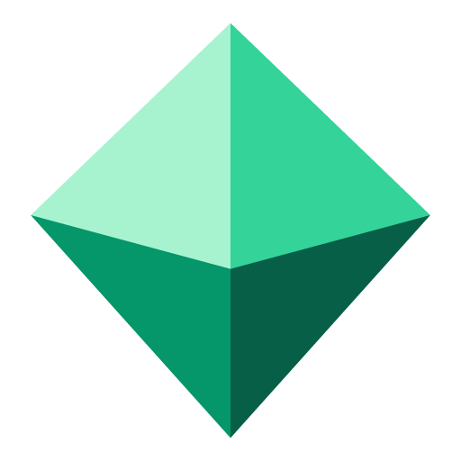

<!--
  Absolute URL, not a relative path: the repo root is the published package, so
  this README is also the npm package page, and npm does not resolve
  repository-relative image paths.
-->


# @rootnative/game-engine

A 2D and 3D game engine for React Native, built to run inside **Expo Go** — no custom native modules, no `expo prebuild`, no config plugins.

- **ECS core** — integer entity ids, TypedArray-backed component buffers, bitmask queries
- **Two-loop architecture** — fixed-timestep simulation on the JS thread, and a render loop of its own (the Skia renderer draws on the UI thread)
- **Skia renderer (2D)** — single `<Canvas>` driven by Reanimated worklets; batched `drawAtlas`, no React reconciliation per frame
- **Three.js renderer (3D)** — `expo-gl` + `expo-three`, ECS-driven meshes, camera, and lights, with a `.glb` loader
- **Physics** — custom circles + AABB solver tailored to arcade games (no rotation, no joints), with contact records, sensors, and collision layers, allocation-free in the hot loop
- **Asset pipeline** — bundled (`require`) and remote (URL) assets behind one Suspense-friendly API
- **Input** — Gesture Handler's hook API on the UI thread

> **Status: `0.0.0-alpha.2`, an alpha.** APIs may shift. See the [CHANGELOG](https://github.com/rootnative/game-engine/blob/main/CHANGELOG.md). The 2D renderer (Skia) and the 3D renderer (`expo-gl` and three.js) run behind the same engine core. The `example/` and `example-3d/` apps in the repository show each one.

## Install

```sh
yarn add @rootnative/game-engine
npx expo install \
  @shopify/react-native-skia \
  expo-asset \
  expo-file-system \
  react-native-gesture-handler \
  react-native-reanimated \
  react-native-worklets
```

That's the 2D set. For the 3D renderer, add `expo-gl`, `expo-three`, and `three` — see [Subpath exports](#subpath-exports).

All of the above are **peer dependencies** — your Expo app owns the SDK version, and the declared ranges are the **Expo SDK 58** band (React 19.3, React Native 0.88, Reanimated 4.7, Worklets 0.13, Gesture Handler 3, Skia 2.14, `expo-file-system` 58, `expo-gl` 58). The engine develops against SDK 58 only. An older or a newer SDK is outside the ranges.

You need no Babel setup. `babel-preset-expo` adds `react-native-worklets/plugin` when `react-native-worklets` is installed, so don't add the plugin yourself.

Wrap your app root with `GestureHandlerRootView` (Gesture Handler requirement).

## Minimal example

```tsx
import { useEffect, useMemo } from 'react';
import { useSharedValue } from 'react-native-reanimated';
import { GestureHandlerRootView } from 'react-native-gesture-handler';
import {
  GameEngine,
  addComponent,
  createEntity,
  createPhysics,
  createWorld,
  defineComponent,
  type System,
} from '@rootnative/game-engine';
import { SkiaRenderer, loadSkiaAtlas, type SkiaAtlas } from '@rootnative/game-engine/renderers/skia';

const world = createWorld({ capacity: 1024 });
const Position = defineComponent(world, { x: 'f32', y: 'f32' });
const Velocity = defineComponent(world, { x: 'f32', y: 'f32' });
const Sprite = defineComponent(world, { atlas: 'u32', frame: 'u16', tint: 'u32' });

const physics = createPhysics({
  world,
  position: Position,
  velocity: Velocity,
  gravity: { x: 0, y: 600 },
});

const id = createEntity(world);
addComponent(world, id, Sprite, { atlas: 0, frame: 0, tint: 0xffffffff });
physics.attach(id, {
  type: 'dynamic',
  position: { x: 100, y: 50 },
  velocity: { x: 0, y: 0 },
  shape: { kind: 'circle', radius: 8 },
});

export default function App() {
  const atlases = useSharedValue<ReadonlyArray<SkiaAtlas>>([]);
  useEffect(() => {
    loadSkiaAtlas(require('./assets/ball.png')).then((a) => {
      atlases.value = [a];
    });
  }, [atlases]);

  const systems = useMemo<ReadonlyArray<System>>(() => [physics.step], []);

  return (
    <GestureHandlerRootView style={{ flex: 1 }}>
      <GameEngine
        world={world}
        systems={systems}
        renderer={
          <SkiaRenderer
            world={world}
            position={Position}
            sprite={Sprite}
            atlases={atlases}
          />
        }
      />
    </GestureHandlerRootView>
  );
}
```

## Subpath exports

| Import | Contains |
| --- | --- |
| `@rootnative/game-engine` | ECS, world, loop, `<GameEngine>`, physics, asset loader |
| `@rootnative/game-engine/renderers/skia` | `<SkiaRenderer>`, `SkiaAtlas`, `loadSkiaAtlas`, `gridFrames` |
| `@rootnative/game-engine/renderers/three` | `<ThreeRenderer>`, `MeshDef`, 3D ECS components, `loadGltf` / `useGltf` |

The renderer split is structural. Skia, `expo-gl`, `expo-three`, and `three` are all **optional** peer dependencies, so consumers never pay for a renderer they don't use — install only the one you wire up. For 3D:

```sh
npx expo install expo-gl expo-three three@0.166
```

## Constraints

- **Expo Go only on the supported path.** Custom dev builds work too, but the engine deliberately avoids anything that would force one.
- **Hermes is the JS engine.** No WebAssembly. That rules out `rapier`/`box2d-wasm`-style physics.
- **Single-touch input.** Each touch has the pointer id `0`.
- **O(N²) broadphase.** Each dynamic body is tested against each other one. Comfortable up to ~200 dynamic bodies.

## License

MIT
